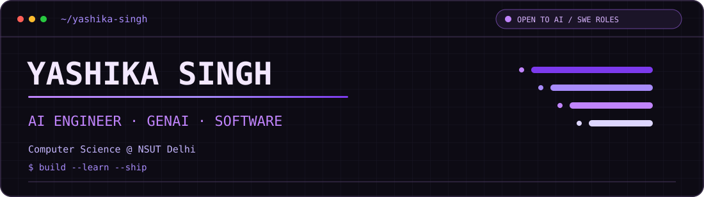
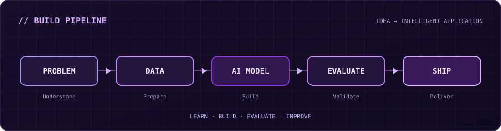

```markdown
<div align="center">



<br/>

**AI / ML ENGINEERING · GENERATIVE AI · SOFTWARE DEVELOPMENT**

Computer Science Undergraduate @ NSUT, Delhi

<br/>

<a href="https://github.com/Yashika1205">

</a>
&nbsp;&nbsp;
<a href="https://drive.google.com/file/d/15r1fEmOCgFfriMTumAmLxar4QmtJ8u8M/view?usp=sharing">

</a>

</div>

---


---

## ◢ FEATURED BUILDS

Selected projects exploring applied AI, intelligent retrieval and conversational systems.

### 01 · MoodMatch — AI-Powered Moodboard Generator

`AI / NLP / EMOTION CLASSIFICATION`

**[Live Application](https://moodmatch-rho.vercel.app/) · [Source Code](https://github.com/chahatsaini13/Moodmatch)**

An AI-powered design assistant that transforms natural-language descriptions into emotion-driven visual moodboards.

**Why it matters** — Visual design is often driven by subjective feelings. MoodMatch bridges the gap between what users express in words and the visual elements that communicate those emotions.

**Engineering highlights**

- **Transformer-based emotion classification** — Uses a RoBERTa-based NLP model to identify emotion from user prompts.
- **Emotion-aware design mapping** — Connects predicted emotions to suitable colors and visual styles.
- **Visual asset retrieval** — Collects relevant imagery to create personalized moodboards.
- **End-to-end integration** — Connects the machine learning pipeline with a Flask backend and interactive frontend.

**System flow**

`Natural Language Prompt` → `Emotion Classification` → `Design Mapping` → `Visual Retrieval` → `Moodboard`

**Tech stack**

`Python` `PyTorch` `Transformers` `Hugging Face` `Flask` `React`

---

### 02 · IntelliNotes — Agentic RAG Knowledge Assistant

`GENAI / AGENTIC AI / RAG / LLMs`

**[Live Application](https://intellinotes-frontend.vercel.app/) · [Source Code](https://github.com/DushyantBhardwaj2/IntelliNotes)**

An AI-powered knowledge assistant that enables users to upload PDF documents, retrieve relevant information, and interact with their knowledge base through context-aware conversations. Built using an Agentic RAG architecture, IntelliNotes combines intelligent query routing, document retrieval, web search, and response verification to deliver reliable, source-grounded answers.

**Why it matters** — Traditional RAG systems can generate inaccurate or unsupported responses when retrieved context is insufficient. IntelliNotes addresses this challenge through context sufficiency grading, document-level retrieval isolation, and a Self-RAG verification loop that checks generated responses against retrieved sources.

**Engineering highlights**

- **Agentic RAG orchestration** — Implements a LangGraph-based workflow with multi-intent query routing for document queries, real-time web searches, and direct conversational responses.
- **Self-RAG hallucination guard** — Verifies generated responses against source excerpts and automatically corrects unsupported claims before returning the final answer.
- **Context-aware retrieval** — Uses ChromaDB vector search, conversational query rewriting, and document-scoped retrieval to maintain relevant context across multi-turn conversations.
- **Page-level PDF citations** — Preserves original PDF page numbers during document ingestion and provides precise source references in generated answers.
- **Intelligent web fallback** — Integrates Tavily search when uploaded documents lack sufficient information, extending the assistant's knowledge beyond the local document collection.
- **Production-ready backend** — Implements FastAPI REST endpoints, API-key authentication, rate limiting, upload validation, and graceful error handling.

**System flow**

`User Query` → `Intent Routing` → `Query Rewriting` → `Vector Retrieval` → `Context Grading` → `Web Fallback (if needed)` → `Response Generation` → `Self-RAG Verification` → `Grounded Answer`

**Tech stack**

`Python` `LangChain` `LangGraph` `FastAPI` `Google Gemini` `ChromaDB` `Tavily` `Streamlit` `Docker`

---

### 03 · AskTube AI — YouTube RAG Chatbot

`GENERATIVE AI / RAG / SEMANTIC SEARCH`

A conversational AI application that lets users ask natural-language questions about YouTube videos and receive answers grounded in their transcript content.

**Why it matters** — Finding specific information inside long videos can be slow. AskTube AI makes video knowledge accessible through conversational search rather than manual navigation.

**Engineering highlights**

- **Transcript processing** — Extracts video transcripts and divides them into manageable text chunks.
- **Semantic embeddings** — Converts transcript segments into vector representations.
- **FAISS retrieval** — Identifies relevant transcript chunks using similarity search.
- **LLM-powered responses** — Uses retrieved context and Groq-hosted language models to generate answers.
- **Interactive application** — Provides a Streamlit-based conversational interface.

**System flow**

`YouTube URL` → `Transcript Extraction` → `Chunking` → `Embeddings` → `FAISS` → `LLM Response`

**Tech stack**

`Python` `LangChain` `FAISS` `Sentence Embeddings` `Groq` `Streamlit`

---

## ◢ STACK

Technologies I use and explore while developing machine learning and software applications.

| CATEGORY | TECHNOLOGIES |
| :--- | :--- |
| **Languages** | `Python` `C++` `C` `SQL` |
| **AI / ML** | `PyTorch` `Scikit-learn` `Hugging Face` `Transformers` |
| **Generative AI** | `LLMs` `RAG` `LangChain` `LangGraph` `FAISS` `Tool Calling` |
| **Frontend** | `React` |
| **Backend** | `Flask` `Streamlit` |
| **Cloud & Data** | `Vertex AI` `BigQuery` |
| **Developer Tools** | `Git` `GitHub` |

---

## ◢ HOW I ENGINEER

My approach is to understand the problem, build a working system and improve it through evaluation.

**01 — Start with the problem.**

Understand what users need before choosing a model, framework or architecture.

**02 — Connect models to applications.**

Go beyond notebooks by integrating machine learning with backend services and user-facing interfaces.

**03 — Design around the data flow.**

Consider how inputs are processed, how information is retrieved and how outputs reach users.

**04 — Evaluate AI behavior.**

Pay attention to relevance, correctness, consistency and reliability rather than treating generated output as automatically correct.

**05 — Iterate through experimentation.**

Use implementation and testing to identify weaknesses and improve the application.

---

## ◢ BUILD PHILOSOPHY

> **A model is only one part of an AI application. The real challenge is turning it into something useful, reliable and accessible.**

<div align="center">



**Problem → Data → Intelligence → Evaluation → Application**

</div>

---

## ◢ TELEMETRY

<div align="center">


<br/>


</div>

<sub>GitHub activity graphics are provided by third-party services and may occasionally be unavailable.</sub>

---

## ◢ CONTACT

Interested in collaborating on AI-powered applications, machine learning projects and software engineering.

| PLATFORM | LINK |
| :--- | :--- |
| **GitHub** | [github.com/Yashika1205](https://github.com/Yashika1205) |
| **LinkedIn** | [Connect with me](https://www.linkedin.com/in/yashika-singh-07b257285/) |
| **Resume** | [View Resume](https://drive.google.com/file/d/111ZiSjtEOsd3kCl0RR9UElEdG7hoClWF/view?usp=sharing) |

<br/>

<div align="center">


<br/><br/>

**LEARN · BUILD · EVALUATE · IMPROVE**

<sub>Yashika Singh · AI / ML · Generative AI · Software Engineering</sub>

</div>
```
