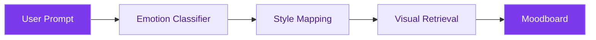
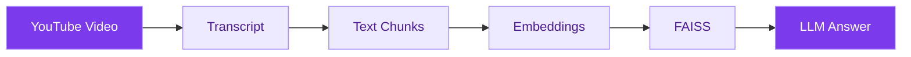
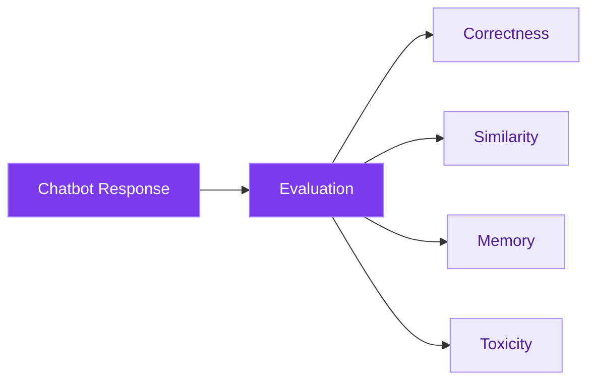
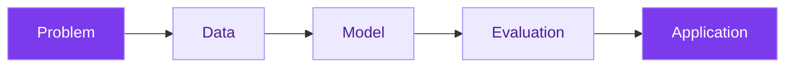

<div align="center">


<br/>

<a href="https://git.io/typing-svg">
  
</a>

<br/>

<b>Computer Science Undergraduate @ NSUT, Delhi</b>

<br/><br/>

<a href="https://github.com/Yashika1205">
  
</a>
<a href="YOUR_LINKEDIN_URL">
  
</a>
<a href="https://drive.google.com/file/d/111ZiSjtEOsd3kCl0RR9UElEdG7hoClWF/view?usp=sharing">
  
</a>

<br/><br/>


</div>

---

## ◢ 01 / ABOUT ME

```python id="nz5g8c"
class AIEngineer:
    def __init__(self):
        self.name = "Yashika Singh"
        self.education = "Computer Science @ NSUT Delhi"
        self.focus = [
            "Machine Learning",
            "Generative AI",
            "Natural Language Processing",
            "Agentic AI"
        ]

    def currently_building(self):
        return "Intelligent AI-powered applications"

    def philosophy(self):
        return "Learn. Build. Evaluate. Improve."
```

I'm passionate about building **intelligent, practical AI applications** that combine machine learning, large language models and modern software engineering.

My interests include **NLP, Retrieval-Augmented Generation, Agentic AI and AI system evaluation**.

I enjoy taking ideas from experimentation to working applications.

---

## ◢ 02 / CURRENT FOCUS

<div align="center">

| | What I'm Working On |
| :---: | :--- |
| 🚀 **Building** | End-to-end AI applications using ML and LLMs |
| 🧠 **Exploring** | Agentic AI, LangGraph and RAG architectures |
| ⚙️ **Improving** | Model evaluation, deployment and system design |
| 🎯 **Goal** | AI/ML Engineering and Software Engineering |

</div>

---

## ◢ 03 / TECH ARSENAL

<div align="center">

### Languages


<br/>


### Machine Learning & Deep Learning


<br/>


### Generative AI & LLM Engineering


<br/>


### Development & Deployment


<br/>


</div>

---

## ◢ 04 / FEATURED PROJECTS

<div align="center">

*Selected projects exploring applied AI, intelligent retrieval and conversational systems.*

</div>

### 01. MoodMatch — AI-Powered Moodboard Generator


**Transforming emotions into visual design using NLP and Transformers.**

MoodMatch is an AI-powered design assistant that converts natural-language prompts into emotion-driven moodboards through emotion classification, color mapping and visual asset retrieval.

**System Architecture**



**Key Features**

- Transformer-based emotion classification.
- Emotion-aware color palette selection.
- Visual asset retrieval and moodboard generation.
- Interactive frontend integrated with an ML-powered backend.

**Tech Stack**

`Python` · `PyTorch` · `Hugging Face` · `Flask` · `React`

<a href="https://moodmatch-rho.vercel.app/">
  
</a>
<a href="https://github.com/chahatsaini13/Moodmatch">
  
</a>

---

### 02. AskTube AI — YouTube RAG Chatbot


**Chat with YouTube videos using Retrieval-Augmented Generation.**

AskTube AI enables users to ask natural-language questions about YouTube videos and receive context-aware responses using semantic retrieval and large language models.

**System Architecture**



**Key Features**

- Retrieval-Augmented Generation pipeline.
- Semantic search using sentence embeddings.
- FAISS vector similarity search.
- Context-aware answer generation using Groq.
- Interactive Streamlit user interface.

**Tech Stack**

`Python` · `LangChain` · `FAISS` · `Groq` · `Streamlit`

---

### 03. AI Chatbot Testing Framework


**Evaluating chatbot reliability, consistency and response quality.**

An AI evaluation framework designed to assess conversational AI behavior across multiple quality dimensions.

**Evaluation Pipeline**



**Evaluation Dimensions**

- Response correctness and relevance.
- Semantic similarity assessment.
- Conversational memory consistency.
- Toxicity and safety evaluation.

**Tech Stack**

`Python` · `NLP` · `Semantic Similarity` · `LLM Evaluation`

---

## ◢ 05 / HOW I BUILD AI SYSTEMS

<div align="center">



</div>

My approach to AI engineering is centered on four principles:

**01 — Problem First**

Understand the problem before choosing a model or framework.

**02 — Build End-to-End**

Connect machine learning models with APIs and real user interfaces.

**03 — Evaluate Carefully**

Consider relevance, correctness, consistency and reliability.

**04 — Keep Improving**

Learn through experimentation, implementation and iteration.

---

## ◢ 06 / GITHUB ANALYTICS

<div align="center">


<br/><br/>


</div>

---

## ◢ 07 / CONNECT WITH ME

<div align="center">

### Let's Build Something Intelligent Together

I'm interested in opportunities involving **AI/ML Engineering, Generative AI and Software Engineering**.

<br/>

<a href="https://github.com/Yashika1205">
  
</a>

<a href="YOUR_LINKEDIN_URL">
  
</a>

<a href="https://drive.google.com/file/d/111ZiSjtEOsd3kCl0RR9UElEdG7hoClWF/view?usp=sharing">
  
</a>

<br/><br/>

---

**Learning deeply · Building thoughtfully · Shipping consistently**

<br/>

</div>


